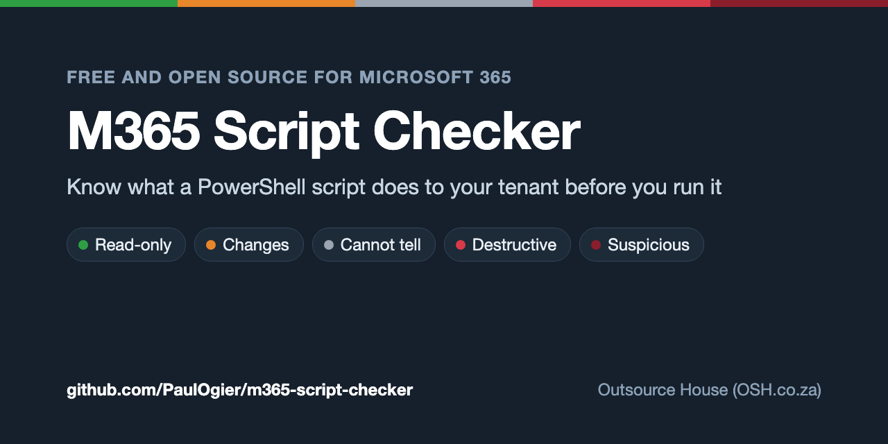

# M365 Script Checker

A PowerShell script checker for Microsoft 365. Before you run a script, it tells you what the script would read, change or delete in your tenant and on your computer. It reads the script as text and never runs it, or PowerShell.

> ⚠️ **This tool is in testing.** It reads a Microsoft 365 PowerShell script and tells you what the script would do, but it can miss things. A READ-ONLY result means the checker found nothing that changes your tenant. It is not a promise that the script is safe. If you are unsure about a script, do not run it: ask someone who knows PowerShell, and test on a non-production tenant first.

It reads Microsoft Graph PowerShell, Exchange Online PowerShell, Teams, SharePoint Online and PnP, Entra ID, and the older AzureAD and MSOnline modules. It is the Microsoft 365 twin of the [GAM Script Checker](https://github.com/PaulOgier/GAMScripts/tree/main/gam-script-checker) and gives the same kind of report.

## Quick start

```
python3 m365check.py script.ps1
```

Python 3.9 or newer, nothing to install. Step-by-step instructions for Mac and Windows are under [Before you start](#before-you-start).

## What it looks like

This script downloads an audit script, checks its SHA-256, and runs it only when the hash matches:

```powershell
Invoke-WebRequest -Uri 'https://raw.githubusercontent.com/PaulOgier/PowerShell/main/Entra%20ID/Get-EntraSmsVoiceMfaExposure.ps1' -OutFile ./Get-EntraSmsVoiceMfaExposure.ps1
if ((Get-FileHash ./Get-EntraSmsVoiceMfaExposure.ps1 -Algorithm SHA256).Hash -ne '0F4E9614E7E394EC156595824879D38F27B05C74E59CB67F55D73FB39692A65B') { Write-Host 'HASH MISMATCH: not running' } else { Unblock-File ./Get-EntraSmsVoiceMfaExposure.ps1; ./Get-EntraSmsVoiceMfaExposure.ps1 -TenantId 00000000-0000-0000-0000-000000000000 -OutputPath ./mfa.csv }
```

`python3 m365check.py run-audit.ps1 --quiet`, with a copy of the audit script in the same folder:

```
VERDICT: 🟠 CHANGES
  13 read-only, 3 changes
  Tenant: READ-ONLY. This computer: CHANGES.

  L2       🟠 CHANGES      removes the downloaded-file warning from a file pinned to sha256 0f4e9614…a65b on line 2
                           > Unblock-File ./Get-EntraSmsVoiceMfaExposure.ps1
  Get-EntraSmsVoiceMfaExposure.ps1:L116 🟠 CHANGES      installs or updates a module on your computer
                           > Install-PackageProvider -Name NuGet -MinimumVersion 2.8.5.201 -Force -Scope CurrentUser
  Get-EntraSmsVoiceMfaExposure.ps1:L120 🟠 CHANGES      installs or updates a module on your computer
                           > Install-Module -Name $missing -Scope CurrentUser -Force -AllowClobber -ErrorAction Stop
```

The tenant side is read-only, because the audit script it would run only reads. The three changes are on this computer: unblocking the downloaded file and installing the Graph modules.

## How is this different from PSScriptAnalyzer?

[PSScriptAnalyzer](https://learn.microsoft.com/powershell/utility-modules/psscriptanalyzer/overview) is Microsoft's linter. It checks how a script is written: style, best practice and likely bugs. This checker answers a different question: what will this script do to my tenant if I run it? It knows which Microsoft 365 cmdlets read, change and delete, which `Connect-MgGraph` scopes are read-only, when `-WhatIf` really is a dry run, and where a script sends data. Use both.

## What the result means

Read the **VERDICT** line first. It is the worst thing the checker found anywhere in the script. The line under it splits that into what touches the tenant and what touches your computer.

| Verdict | Meaning | What to do |
|---|---|---|
| READ-ONLY | Every command it found only reads | The checker found nothing that changes anything. Still read the SECURITY lines, and if the script came from someone you do not trust, have a person read it too |
| CHANGES | Creates, updates, enables, disables, grants or moves something, or installs a module on your computer | Read every CHANGES line before running |
| DESTRUCTIVE | Deletes, clears or purges something, or erases files on your computer | Stop. Be sure you want every DESTRUCTIVE line |
| CANNOT TELL | Something is only decided when the script runs (a method in a variable, a splat it could not read, another program or script), or no command was visible | Treat it as dangerous until someone checks it |
| SUSPICIOUS | Runs text or downloaded code, runs a file it downloaded, renames a command, writes code into a file or registry key, loads .NET or COM objects it cannot read, or sends data to a host that is not Microsoft's | Do not run it |

Lines marked **SECURITY** weaken protection or widen access: mail forwarding, inbox rules, mailbox permissions, admin roles, app secrets, Conditional Access, MFA and password changes, audit logging, external sharing, sending email, Defender settings, remoting, persistence (the PowerShell profile, a Run key, the Startup folder, the hosts file), a credential written into the script, a password turned back into plain text, and a `Connect-MgGraph` that asks for anything but read-only scopes. They are listed whatever their level.

A script that demands `#Requires -RunAsAdministrator` gets a line saying so.

Where Microsoft documents a way to undo a deletion, the line carries an **UNDO** note (a deleted user can be restored for 30 days, a SharePoint site for 93) with the page it came from. No UNDO line means Microsoft documents no window, not that nothing can be recovered.

## How it decides

- **The verb decides the level.** PowerShell's [approved verbs](https://learn.microsoft.com/powershell/scripting/developer/cmdlet/approved-verbs-for-windows-powershell-commands) each have a documented meaning: `Get`, `Find`, `Search`, `Test`, `Export` read; `Set`, `New`, `Add`, `Update`, `Enable`, `Disable`, `Grant`, `Revoke`, `Invoke` change; `Remove`, `Clear`, `Uninstall` delete. A verb that is not on the list is CANNOT TELL. A read verb on a cmdlet the checker does not know is CANNOT TELL too, because `Get-WindowsAutopilotInfo -Online` uploads to the tenant.
- **`verbs/policy.json` overrides the verb** where it lies: `Search-Mailbox -DeleteContent` deletes, `New-ComplianceSearchAction -Purge` purges, the sign-in cmdlets (`Connect-MgGraph`, `Connect-ExchangeOnline` and the rest) only sign in. Microsoft 365 modules use some read-sounding verbs for writes, so `Import`, `Join`, `Request`, `Skip`, `Hide`, `Connect` and `Disconnect` count as changes (`Request-SPOPersonalSite` creates OneDrives, `Import-TransportRuleCollection` replaces every mail flow rule, `Connect-Mailbox` links a mailbox to an account), and so do `Confirm-MgRiskyUserCompromised`, domain verification and the eDiscovery exports. Exchange's own verbs are read too: `Delete-QuarantineMessage` deletes, `Release-QuarantineMessage` changes. `developers/check_module_verbs.py` rechecks every cmdlet in the Graph, Entra, Exchange, PnP, SharePoint, Teams, AzureAD and MSOnline modules against the Graph SDK's own list of HTTP methods.
- **Raw HTTP is classified by its literal method.** `Invoke-MgGraphRequest`, `Invoke-RestMethod`, `Invoke-WebRequest` and `Start-BitsTransfer`: GET reads, POST/PUT/PATCH change, DELETE deletes. A `-Method` held in a variable is CANNOT TELL. A Graph `$batch` is judged by the methods of the requests in its body; a body the checker cannot parse, or any request without a plain method, is CANNOT TELL. The host is read even when the path holds a variable (`"https://graph.microsoft.com/v1.0/users/$id"`).
- **Where the call goes matters as much as the method.** Microsoft's API hosts are trusted. A code-hosting site (GitHub, the PowerShell Gallery, aka.ms) is fine to download from and SUSPICIOUS to post to, because that is how collected tenant data leaves. An address any tenant can own (`*.sharepoint.com`, `*.onmicrosoft.com`) gets a note that it may not be yours. A post to an address anyone can create to receive data (a Teams webhook, a Logic App, Azure storage, a web app) is SUSPICIOUS, and so is anything else with a POST, a `-Body` or `-Form`, or a variable in the address of a GET. A user name before `@` in an address does not hide the host. `Invoke-MgGraphRequest` and the Intune module's `Invoke-MSGraphRequest` send your sign-in token to whatever address they are given, so a call to any host that is not Microsoft's is SUSPICIOUS.
- **A downloaded file that is then run is SUSPICIOUS.** The checker remembers every `-OutFile`, `-OutputFilePath` and `-Destination`, a download piped into `Set-Content` or `Out-File`, and a copy or extract of a download, and flags a later `& .\file.exe`, `Start-Process`, `Invoke-Item` or `Unblock-File` on it.
- **A download pinned by its SHA-256 is read, not flagged.** When `(Get-FileHash <file> [-Algorithm SHA256]).Hash` is compared with `-eq` or `-ne` to a literal 64-character hash (`.ToUpper()` or `.ToLower()` on either side is fine), and the downloaded `.ps1` is unblocked and run only where the hash matched (the `if` block of an `-eq`, the `else` of an `-ne`, or everything after an `-ne` block that always ends in `exit`, `throw` or `return`), the checker looks for a file with that hash next to the script, in the current folder and in each `--pin-dir`, and reads it as the script that runs. With no such file, the run is CANNOT TELL and says which hash to look for. MD5, SHA1, a path or hash held in a variable, a hash saved to a variable before the `if`, a check that can fall through, a use outside that branch, any command between the check and the run other than `Unblock-File` and a `Write-Host` message (a `Set-Location` included), a script that redefines or aliases `Get-FileHash` or `Unblock-File`, and a stop by `throw` in a script with a `trap` all stay SUSPICIOUS.
- **Splats and variables are followed one level.** `Connect-MgGraph @connect` is read when `$connect` is a literal hashtable in the same file, `-Scopes $scopes` when `$scopes` is a literal array, and `& $cmd` when `$cmd` is a literal string. A variable set more than once, or any way but `$x = 'literal'` (after a `;`, typed, scoped, by `Set-Variable`, as a parameter or loop variable), is CANNOT TELL. A splat table is the one in force where the call sits; one redefined in a branch, copied to another variable or changed through a variable key is CANNOT TELL. Anything built from an expression or a command is CANNOT TELL.
- **Aliases are reported** (`rm`, `iex`, `%`) with the full name to write instead. Creating one (`Set-Alias`, `New-Alias`, a write to the `Alias:` or `Function:` drive) is SUSPICIOUS when the new name can pass for another command. That means it is already an alias for something else, it is a program name, or its verb reads milder than the command behind it (`Get-MgUser` pointing at `Remove-MgUser`). A new short name like `ll` is CHANGES, and a call to it is judged as the command behind it. An alias given the name of a cmdlet the checker knows is SUSPICIOUS, and calls to that name are still judged as the cmdlet.
- **A function defined in the script is judged by its body**, not its name: a `Get-Report` whose body deletes shows the delete, and calling it adds nothing. A function given the name of a cmdlet the checker knows does not hide that cmdlet: the definition may never run, so calls are judged as the cmdlet.
- **`& { ... }` and `. { ... }` blocks are read** line by line, like any other code.
- **Some calls outside the cmdlets are read too:** SharePoint CSOM `.DeleteObject()`, `.Recycle()` and permission-inheritance changes, any `.Delete()` method, and `[IO.File]`/`[IO.Directory]` writes and deletes.
- **Commands inside `"$( )"` and here-strings run.** The checker reads them like any other line and marks them "runs inside a $( ) in a string".
- **Web typography is read as PowerShell reads it.** PowerShell treats non-breaking spaces, vertical tabs, form feeds, NEL, the Unicode line and paragraph separators, en and em dashes and curly quotes as spaces, dashes and quotes, and so does the checker. Without that, an indent copied from a web page can hide the command after it. Where a `#` could be a comment or part of a word, the script is read both ways and the worse reading is kept. A UTF-16 file is read by its byte-order mark; a file that is not UTF-8 is read as UTF-8 and as Windows-1252, and the worse reading is kept.
- **A tenant check is recognised.** A `Connect-*` with no tenant named normally says so; when a later line compares the session's `TenantId` (from `Get-ConnectionInformation` or `Get-MgContext`) with a literal tenant id and stops, it says "tenant guarded" instead, or warns when the check comes after the first change.
- **More than one change is not all-or-nothing.** The summary says so: if change 11 fails, changes 1 to 10 have already happened.
- **Known parameter traps get a note**, from `param_notes` in `verbs/policy.json`: a distribution group in a transport rule's `-SentTo` fails when the rule is created.
- **Only a bare `-WhatIf` turns a write into a report.** `-WhatIf:$x` is whatever `$x` is when the script runs, so it does not. A cmdlet in `cmdlet_overrides` keeps its level with `-WhatIf`, because not every one of them honours it.
- **Local damage is separate from tenant damage.** `Remove-Item -Recurse` (or a `Get-ChildItem -Recurse` piped into `Remove-Item`), `Set-ExecutionPolicy`, `Install-Module`, `vssadmin delete shadows`, `wevtutil cl`, Defender settings, remoting, scheduled tasks, local accounts, services, event logs, the firewall, registry and hosts-file writes, and the code inside `powershell -Command` or `-EncodedCommand` show under "This computer".

## What it cannot see

Each of these is either reported as CANNOT TELL or is invisible to the checker. A script that uses them needs a human read.

- A command name built by string concatenation, `& ("Remove-" + "MgUser")`.
- Values that arrive from a file, a pipeline or a prompt.
- Anything a job, remote session, `Start-Process` or `Import-Module` of a file does. A second `.ps1` called by a path is read and its lines are listed under its name when the file is on this computer (`$HOME`, `~`, `$env:NAME` and `$PSScriptRoot` are filled in); otherwise it is CANNOT TELL. `known_scripts` in `verbs/policy.json` says what a known community script does (`Get-WindowsAutopilotInfo -Online` uploads to the tenant), but a file judged only by its name is never milder than CANNOT TELL, because anyone can give a script that name. A script on a network share is never opened. A literal `{ }` block given to `Invoke-Command` or `Start-Job` is read line by line; a block held in a variable is not.
- A helper defined in another file of the same module. A deletion done through one reads as CANNOT TELL, not DESTRUCTIVE.
- .NET and COM called directly (`[Reflection.Assembly]::Load`, `WebClient`, `[Diagnostics.Process]::Start`, `WScript.Shell`) beyond the patterns it names.
- A cmdlet whose noun it does not know: a write or delete verb keeps its level and counts as "Could be either", a read verb is CANNOT TELL, and the line says so.
- A script that is pure .NET with no cmdlet in it reports "found nothing it can read". That is a warning, not a pass.

## Before you start

You need two things:

1. **The whole `m365-script-checker` folder**, not just `m365check.py`. The checker reads the `verbs` folder next to it and will not work without it. You can ignore the `developers` folder: it holds the self-check.
2. **Python 3.9 or newer.** Nothing else to install. PowerShell is not needed and is never called.

There are two ways to use it:

- **Paste mode** checks a command or a whole script you copied from somewhere (a web page, a chat, an email). Blank lines inside the paste are fine; the checker stops at the first blank line you type yourself. It prints how many lines it read, so check that number against what you pasted.
- **File mode** checks a script saved as a file (`.ps1`, `.psm1` or `.txt`).

## Mac

1. Press **Cmd+Space**, type `Terminal`, press **Enter**.
2. Type `cd` followed by a space, drag the `m365-script-checker` folder from Finder into the Terminal window, press **Enter**.
3. Paste mode: type `python3 m365check.py`, press **Enter**, paste with **Cmd+V**, press **Enter twice**.
4. File mode: type `python3 m365check.py` followed by a space, drag the script file into the window, press **Enter**.

## Windows

1. Open the `m365-script-checker` folder in File Explorer, click the address bar, type `cmd`, press **Enter**.
2. Paste mode: type `py m365check.py`, press **Enter**, paste with **Ctrl+V**, press **Enter twice**.
3. File mode: type `py m365check.py` followed by a space, drag the script file into the window, press **Enter**.

If `py --version` does not print `Python 3.9` or higher, install Python from [python.org/downloads](https://www.python.org/downloads/).

## Options

```
python3 m365check.py SCRIPT [SCRIPT ...] [--json] [--quiet] [--pin-dir DIR]
python3 m365check.py                 paste mode (so does --paste)
some-command | python3 m365check.py -
```

`--quiet` hides READ-ONLY lines that carry no SECURITY note. `--pin-dir` names a folder holding a copy of a download the script pins by SHA-256; give it more than once for more folders. `--json` prints the findings as JSON. The exit code is the worst verdict: 0 READ-ONLY, 1 CHANGES, 2 CANNOT TELL, 3 DESTRUCTIVE, 4 SUSPICIOUS.

## Self-check

```
python3 developers/test_m365check.py
```

Runs a hostile corpus (downloaded code, download-then-run, exfiltration, alias shadowing, `&&` chaining, persistence writes, variable methods, splats, keyword false positives, and every miss found in the real-script audit). When this folder sits inside a checkout of [PaulOgier/PowerShell](https://github.com/PaulOgier/PowerShell), it also checks that repo's `Entra ID/Get-EntraSmsVoiceMfaExposure.ps1`, which must read as tenant READ-ONLY.

`developers/corpus/real/` is a set of 62 real scripts: vendor modules and samples, Reddit posts, ordinary admin scripts, and patterns written from public write-ups. The scripts belong to their authors and are not published here; `SOURCES.md` gives the URL of each, so you can fetch them into that folder yourself. `RESULTS.md` has the expected and actual verdict of each. `python3 developers/check_real_corpus.py` reruns them, and any script that still differs is explained in `RESULTS.md`.

## Licence

Apache 2.0, see `LICENSE` at the repository root. Keep the attribution block at the top of `m365check.py` if you redistribute it.
